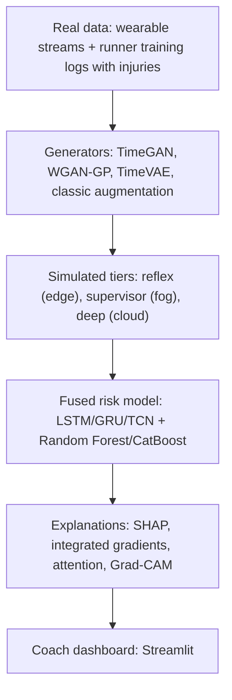

# SynAthlete-AIoT

An Explainable AIoT Framework for Athlete Injury-Risk Prediction Using GAN-Synthesized Wearable Data. Software-only: the edge, fog and cloud tiers are simulated as separate programs on one machine.

> **Status:** active development (PBL-I, 21CSE292P). No result is reported here until code has produced it and it is recorded under `experiments/`.

## Why this project
- A May 2026 AIoT athlete-health framework (Appl. Sci. 16(9):4542) designs wearable + edge-fog-cloud monitoring but leaves anomaly detection, injury-risk prediction and explainability unimplemented.
- Much injury-risk ML uses one-time snapshots instead of day-by-day data.
- No public dataset pairs high-frequency physiological streams with real injury outcomes.

## Pipeline

Rules that are never relaxed: split by person; fit everything on training folds only; synthetic data never in validation or test; every number comes from a file written by code.

## Datasets
Raw data is not stored here. Download list, links and audit: [`docs/DATASETS.md`](docs/DATASETS.md).

## Get started (Windows)
See [`docs/SETUP_WINDOWS.md`](docs/SETUP_WINDOWS.md). Then `python tasks.py check`.

## Where things are
| Path | What |
|---|---|
| `AGENTS.md`, `CLAUDE.md` | Rules for AI coding tools and contributors |
| `docs/PROJECT_BRIEF.md` | The project, Review 1 content, how each part is used |
| `docs/PLAN.md`, `docs/STATE.md` | Build order and current status |
| `docs/VIVA_NOTES.md` | Plain-language explanations and likely viva questions |
| `src/` | data, gen, pipeline, models, xai, dashboard |
| `experiments/` | One folder per run: config.yaml + metrics.json |
| `tasks.py` | `python tasks.py check \| snapshot \| data \| baselines \| ...` |
